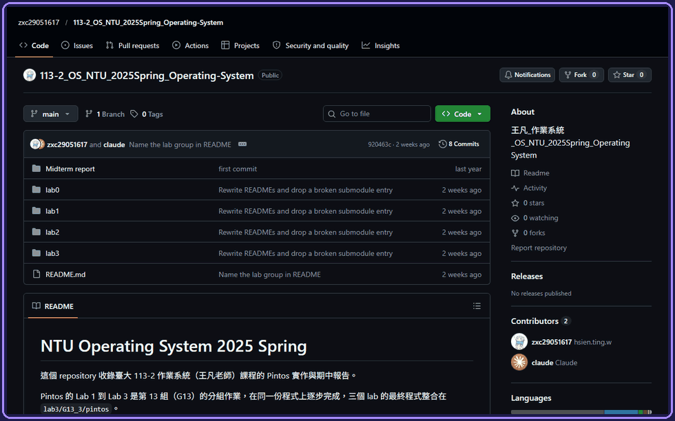

<div align="center">

[](https://github.com/DenverCoder1/readme-typing-svg)


</div>

<br>

<p>


```text
hsien.ting.w@github
──────────────────────────────────
🏫 NTU BEBI | 臺大生醫電子與資訊學研究所
🎓 Advisor: Prof. Yen-Jen Oyang

🔬 Research Labs & Collaborations
   ├─ Molecular Bioinformatics Lab
   ├─ CMJM Lab
   └─ Computational Systems Biology Lab

🏛️ Previous Research Experience
   └─ Academia Sinica | IIS
      └─ Lab of Systems and Network Biology
         Summer Research Intern · 2026

🧬 Research & Projects
   ├─ Machine Learning × Emergency Medical Services
   ├─ Virtual Cell & Virtual Embryo
   ├─ Medical Time-Series Forecasting
   ├─ Knowledge Distillation & Edge AI
   ├─ Biomedical AI
   └─ Agentic AI × Bioinformatics

🌱 Exploring
   └─ Foundation Models · Embedded Systems

💻 Programming: Python · C/C++ · Java · Bash
⚡ HDL: Verilog
🛠️ Tools: Git · Linux · Arduino · Raspberry Pi · 8051

✨ Stay curious. Keep exploring.
```
</p>

<br clear="left" />

<h2 align="center">✦ ˚ Research ˚ ✦</h2>

| | Project | 說明 |
| :---: | --- | --- |
| 🫀 | [**HRV Early Warning**](https://github.com/zxc29051617/Biomedical-Innovation-2026_HRV-EarlyWarning) | 重症病人的循環風險預警：用 MIMIC-III 加護病房資料中的 ECG 與 HRV 變化，預測病人未來 6 小時內是否需要開始使用升壓劑；目前也在做心導管檢查前的 ECG 急性冠狀動脈阻塞辨識 |
| 🧫 | **Virtual Cell Challenge 2026** 🔒 | 在臺大資工黃宣誠老師實驗室參加 Arc Institute 的 Virtual Cell Challenge：預測模型沒看過的 CRISPRi 基因擾動，會讓單細胞的基因表達怎麼變化 |
| 🐣 | **EmbryoWeave** 🔒 | 參加 Virtual Embryo Challenge 2026 的 Track 2（Agent Team）：預測胚胎在未公開時間點的細胞組成 |
| 🤖 | **Agentic scRNA-seq** 🔒 | 中研院資訊所暑期實習：用 deep agents 協助設定和檢查單細胞 RNA-seq 的分析流程 |
| 🩺 | **Personal Health Twin** 🔒 | BUILDMODE GEN-AI 黑客松 2026（AI for Taiwan／Social Impact 賽道）：每個人一份跟著自己走的健康紀錄，從長照機構開始，用 FHIR／TW Core 格式在醫院、長照與家之間交換 |

<p align="right"><sub>🔒 = private repo，程式碼未公開</sub></p>

<h2 align="center">✦ ˚ Projects ˚ ✦</h2>

| | Project | 說明 |
| :---: | --- | --- |
| 💊 | [**DeepKG-MMDRP**](https://github.com/zxc29051617/DeepKG-MMDRP-DrugResponse) | 在 MMDRP 藥物反應預測中加入 DRKG 知識圖譜 TransE embedding 作為第三模態<br>`AttentiveFP GNN` `DRKG TransE` `LMF` · 醫學電資整合創意專題(二) 114-2 |
| 📊 | [**Bubble Sort Visualizer**](https://github.com/zxc29051617/Software-Engineering_group4) | DSA 課程軟體工程第 4 組：十種排序演算法的互動式教學網站，可以逐步播放、對照虛擬碼、讓演算法比賽 · [線上網站](https://zxc29051617.github.io/Software-Engineering_group4/) |
| 🌳 | [**Personal Budget Book**](https://github.com/zxc29051617/OOP-G13-Personal-Budget-Book) | 物件導向程式語言 G13 期末專題：Java Swing 記帳本，管理預算、定期交易與報表圖表，用種樹機制鼓勵每天記帳 |

<h2 align="center">✦ ˚ Courses ˚ ✦</h2>

<p align="center">
  
</p>

<table>
  <tr>
    <td valign="top">
      <h3>📘 𝗖𝗦𝗜𝗘</h3>
      <ul>
        <li>𝐂𝐒𝐈𝐄 𝟓𝟒𝟎𝟎: <a href="https://github.com/zxc29051617/113-2_AI_NTU_2025Spring_Artificial-Intelligence">𝐀𝐈 (𝐀𝐫𝐭𝐢𝐟𝐢𝐜𝐢𝐚𝐥 𝐈𝐧𝐭𝐞𝐥𝐥𝐢𝐠𝐞𝐧𝐜𝐞)</a></li>
        <li>𝐂𝐒𝐈𝐄 𝟓𝟎𝟒𝟓: <a href="https://github.com/zxc29051617/113-2_IDSP_NTU_2025Spring_Introduction-to-Digital-Signal-Processing">𝐈𝐃𝐒𝐏 (𝐈𝐧𝐭𝐫𝐨𝐝𝐮𝐜𝐭𝐢𝐨𝐧 𝐭𝐨 𝐃𝐢𝐠𝐢𝐭𝐚𝐥 𝐒𝐢𝐠𝐧𝐚𝐥 𝐏𝐫𝐨𝐜𝐞𝐬𝐬𝐢𝐧𝐠)</a></li>
        <li>𝐂𝐒𝐈𝐄 𝟓𝟐𝟏𝟎: <a href="https://github.com/zxc29051617/113-2_WEB_NTU_2025Spring_Web-Programming-and-Applications">𝐖𝐞𝐛 𝐏𝐫𝐨𝐠𝐫𝐚𝐦𝐦𝐢𝐧𝐠 𝐚𝐧𝐝 𝐀𝐩𝐩𝐥𝐢𝐜𝐚𝐭𝐢𝐨𝐧𝐬</a></li>
        <li>𝐂𝐒𝐈𝐄 𝟓𝟎𝟒𝟑: <a href="https://github.com/zxc29051617/114-1_ML_NTU_2025Fall_Machine-Learning">𝐌𝐋 (𝐌𝐚𝐜𝐡𝐢𝐧𝐞 𝐋𝐞𝐚𝐫𝐧𝐢𝐧𝐠)</a></li>
        <li>𝐂𝐒𝐈𝐄 𝟓𝟎𝟒𝟐: <a href="https://github.com/zxc29051617/114-2_NLP_NTU_2026Spring_Natural-Language-Processing">𝐍𝐋𝐏 (𝐍𝐚𝐭𝐮𝐫𝐚𝐥 𝐋𝐚𝐧𝐠𝐮𝐚𝐠𝐞 𝐏𝐫𝐨𝐜𝐞𝐬𝐬𝐢𝐧𝐠)</a></li>
      </ul>
    </td>
    <td valign="top">
      <h3>📗 𝗘𝗘</h3>
      <ul>
        <li>𝐄𝐄 𝟓𝟏𝟕𝟑: <a href="https://github.com/zxc29051617/113-2_OS_NTU_2025Spring_Operating-System">𝐎𝐒 (𝐎𝐩𝐞𝐫𝐚𝐭𝐢𝐧𝐠 𝐒𝐲𝐬𝐭𝐞𝐦𝐬)</a></li>
        <li>𝐂𝐨𝐦𝐦𝐄 𝟓𝟎𝟑𝟎: <a href="https://github.com/zxc29051617/114-1_TFW_NTU_2025Fall_Time-Frequency-Analysis-and-Wavelet-Transform">𝐓𝐅𝐖 (𝐓𝐢𝐦𝐞-𝐅𝐫𝐞𝐪𝐮𝐞𝐧𝐜𝐲 𝐀𝐧𝐚𝐥𝐲𝐬𝐢𝐬 𝐚𝐧𝐝 𝐖𝐚𝐯𝐞𝐥𝐞𝐭 𝐓𝐫𝐚𝐧𝐬𝐟𝐨𝐫𝐦)</a></li>
        <li>𝐄𝐄𝐄 𝟓𝟎𝟓𝟑: <a href="https://github.com/zxc29051617/114-2_CV_NTU_2026Spring_Computer-Vision">𝐂𝐕 (𝐂𝐨𝐦𝐩𝐮𝐭𝐞𝐫 𝐕𝐢𝐬𝐢𝐨𝐧)</a></li>
      </ul>
    </td>
    <td valign="top">
      <h3>📙 𝗢𝘁𝗵𝗲𝗿𝘀</h3>
      <ul>
        <li>𝐄𝐓 𝟑𝟓𝟎𝟐𝟕𝟎𝟏: <a href="https://github.com/zxc29051617/114-1_NTUST_2025Fall_ComputerOrganization">𝐂𝐎 (𝐂𝐨𝐦𝐩𝐮𝐭𝐞𝐫 𝐎𝐫𝐠𝐚𝐧𝐢𝐳𝐚𝐭𝐢𝐨𝐧)</a> <sub>NTUST</sub></li>
        <li>𝐄𝐒𝐎𝐄 𝟐𝟎𝟏𝟑: <a href="https://github.com/zxc29051617/114-2_OOP_NTU_2026Spring_Object-Oriented-Programming">𝐎𝐎𝐏 (𝐎𝐛𝐣𝐞𝐜𝐭-𝐎𝐫𝐢𝐞𝐧𝐭𝐞𝐝 𝐏𝐫𝐨𝐠𝐫𝐚𝐦𝐦𝐢𝐧𝐠)</a></li>
      </ul>
    </td>
  </tr>
</table>

<h2 align="center">✦ ˚ GitHub Stats ˚ ✦</h2>

<p align="center">
  
  
</p>

<!-- Snake and languages card are generated daily by .github/workflows/profile-assets.yml -->
<p align="center">
  <picture>
    <source media="(prefers-color-scheme: dark)" srcset="https://raw.githubusercontent.com/zxc29051617/zxc29051617/output/snake-dark.svg" />
    <source media="(prefers-color-scheme: light)" srcset="https://raw.githubusercontent.com/zxc29051617/zxc29051617/output/snake.svg" />
    
  </picture>
</p>

<h2 align="center">✦ ˚ Contact me ˚ ✦</h2>

<p align="center">
  Feel free to reach out ✧ 想聊研究、合作或交朋友都歡迎
  <br><br>
  <a href="mailto:xiaoliang29051617@gmail.com"></a>
  <a href="https://www.facebook.com/hsien.ting.wang.2025"></a>
  <a href="https://www.instagram.com/hsien_ting.w/"></a>
  
</p>

<!-- Spotify card: https://github.com/magic-ike/spotify-data-card -->
<p align="center">
  <a href="https://data-card-for-spotify.herokuapp.com/card?user_id=31vtogae42jisckvdlayvjsmhqqi">
    
  </a>
</p>

<p align="center"><sub>˚ ✦ . ˚ ✧ thanks for visiting ✧ ˚ . ✦ ˚</sub></p>
