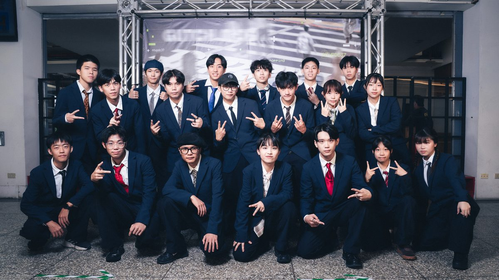

<div align="center">

[](https://github.com/DenverCoder1/readme-typing-svg)


</div>

<br>

<table>
  <tr>
    <td align="center" valign="middle" width="380">
      
    </td>
    <td valign="middle">
```text
hsien.ting.w@github
──────────────────────────────────
🏫 NTU BEBI | 國立臺灣大學生醫電子與資訊學研究所 資訊組
🎓 Advisor: Prof. Yen-Jen Oyang
🔬 Lab: Molecular Bioinformatics Lab

🤝 Collaborations
   ├─ Computational Multidata Junction in Medicine Lab
   └─ Computational Systems Biology Lab

🏛️ Previous Research Experience
   └─ Academia Sinica | IIS
      └─ Lab of Systems and Network Biology
         Summer Research Intern · 2026

🧬 Research & Projects
   ├─ Machine Learning × Emergency Medical Services
   ├─ Virtual Cell & Virtual Embryo
   ├─ Medical Time-Series Forecasting
   ├─ Knowledge Distillation & Edge AI
   ├─ Biomedical AI
   └─ Agentic AI × Bioinformatics

🌱 Exploring
   └─ Foundation Models · Embedded Systems

💻 Programming: Python · C/C++ · Java · Bash
⚡ HDL: Verilog
🛠️ Tools: Git · Linux · Arduino · Raspberry Pi · 8051

✨ Stay curious. Keep exploring.
```
</p>

<br clear="left" />

<h2 align="center">✦ ˚ Research ˚ ✦</h2>

| | Project | 說明 |
| :---: | --- | --- |
| 🫀 | [**HRV Early Warning**](https://github.com/zxc29051617/Biomedical-Innovation-2026_HRV-EarlyWarning) | 重症病人的循環風險預警：用 MIMIC-III 加護病房資料中的 ECG 與 HRV 變化，預測病人未來 6 小時內是否需要開始使用升壓劑；目前也在做心導管檢查前的 ECG 急性冠狀動脈阻塞辨識 |
| 📈 | **Influenza Trend Forecasting** | 用時間序列基礎模型 TimesFM 3.0 推估臺灣的流感趨勢 |
| 🪶 | [**Crisis-aware Medical AI**](https://www.twaicoe.org/crisis-aware-medical-ai-from-foundational-intelligence-to-lightweight-deployment-cn) | 國科會計畫子計畫三：醫療 AI 的 Knowledge Distillation & Edge Deployment |
| 🧫 | **Virtual Cell Challenge 2026** 🔒<br><sub>Team NTU_JHLab</sub> | 零樣本擾動預測：只給三種細胞未經處理的對照組，預測 CRISPRi 關掉 300 個基因後，18,533 個基因的表現怎麼變化 |
| 🐣 | **Virtual Embryo Challenge 2026** 🔒<br><sub>Team SKT BioDynamics</sub> | 用已公開的胚胎發育時間點（每個細胞有 498 個基因的表現量與三維座標），預測未公開時間點會出現哪些細胞群；參加的 Track 2（Agent Team）規定由 LLM agent 自己提出方法、寫程式、評估與修改 |
| 🤖 | **Agentic scRNA-seq** 🔒 | 用 LangChain Deep Agents 自動化單細胞 RNA-seq 分析：coordinator 帶四個 subagent，把對話需求轉成分析設定，自動跑完從 FASTQ 到細胞註解的 26 步流程，每一步由 judge 把關、關鍵決定交給人確認，最後核對報告裡的每個數字 |
| 🩺 | **Personal Health Twin** 🔒 | BUILDMODE GEN-AI 黑客松 2026（AI for Taiwan／Social Impact 賽道）：臺灣高齡化、醫師不足，照服員每天的觀察卻進不了醫療紀錄，紀錄也分散在醫院、長照與家。我們讓照服員說一句話就產生醫師看得懂的紀錄，並用 FHIR／TW Core 讓紀錄跟著人走 |

<p align="right"><sub>🔒 = private repo，程式碼未公開</sub></p>

<h2 align="center">✦ ˚ Courses ˚ ✦</h2>

<p align="center">
  
</p>

<table>
  <tr>
    <td valign="top">
      <h3>📘 𝗖𝗦𝗜𝗘</h3>
      <ul>
        <li>𝐂𝐒𝐈𝐄 𝟓𝟐𝟏𝟎: <a href="https://github.com/zxc29051617/113-2_WEB_NTU_2025Spring_Web-Programming-and-Applications">𝐖𝐞𝐛 𝐏𝐫𝐨𝐠𝐫𝐚𝐦𝐦𝐢𝐧𝐠 𝐚𝐧𝐝 𝐀𝐩𝐩𝐥𝐢𝐜𝐚𝐭𝐢𝐨𝐧𝐬</a></li>
        <li>𝐂𝐒𝐈𝐄 𝟓𝟎𝟒𝟓: <a href="https://github.com/zxc29051617/113-2_IDSP_NTU_2025Spring_Introduction-to-Digital-Signal-Processing">𝐈𝐃𝐒𝐏 (𝐈𝐧𝐭𝐫𝐨𝐝𝐮𝐜𝐭𝐢𝐨𝐧 𝐭𝐨 𝐃𝐢𝐠𝐢𝐭𝐚𝐥 𝐒𝐢𝐠𝐧𝐚𝐥 𝐏𝐫𝐨𝐜𝐞𝐬𝐬𝐢𝐧𝐠)</a></li>
        <li>𝐂𝐒𝐈𝐄 𝟓𝟒𝟎𝟎: <a href="https://github.com/zxc29051617/113-2_AI_NTU_2025Spring_Artificial-Intelligence">𝐀𝐈 (𝐀𝐫𝐭𝐢𝐟𝐢𝐜𝐢𝐚𝐥 𝐈𝐧𝐭𝐞𝐥𝐥𝐢𝐠𝐞𝐧𝐜𝐞)</a></li>
        <li>𝐂𝐒𝐈𝐄 𝟓𝟎𝟒𝟑: <a href="https://github.com/zxc29051617/114-1_ML_NTU_2025Fall_Machine-Learning">𝐌𝐋 (𝐌𝐚𝐜𝐡𝐢𝐧𝐞 𝐋𝐞𝐚𝐫𝐧𝐢𝐧𝐠)</a></li>
        <li>𝐂𝐒𝐈𝐄 𝟓𝟎𝟒𝟐: <a href="https://github.com/zxc29051617/114-2_NLP_NTU_2026Spring_Natural-Language-Processing">𝐍𝐋𝐏 (𝐍𝐚𝐭𝐮𝐫𝐚𝐥 𝐋𝐚𝐧𝐠𝐮𝐚𝐠𝐞 𝐏𝐫𝐨𝐜𝐞𝐬𝐬𝐢𝐧𝐠)</a></li>
        <li>𝐂𝐒𝐈𝐄 𝟓𝟒𝟐𝟖: 𝐂𝐕𝐏𝐃𝐋 (𝐂𝐨𝐦𝐩𝐮𝐭𝐞𝐫 𝐕𝐢𝐬𝐢𝐨𝐧 𝐏𝐫𝐚𝐜𝐭𝐢𝐜𝐞 𝐰𝐢𝐭𝐡 𝐃𝐞𝐞𝐩 𝐋𝐞𝐚𝐫𝐧𝐢𝐧𝐠) 🔒</li>
        <li>𝐂𝐒𝐈𝐄 𝟓𝟎𝟓𝟒: 𝐀𝐂𝐃 (𝐀𝐝𝐯𝐚𝐧𝐜𝐞𝐝 𝐂𝐨𝐦𝐩𝐢𝐥𝐞𝐫 𝐃𝐞𝐬𝐢𝐠𝐧) 🔒</li>
      </ul>
    </td>
    <td valign="top">
      <h3>📗 𝗘𝗘</h3>
      <ul>
        <li>𝐄𝐄 𝟒𝟎𝟐𝟐: 𝐃𝐒 (𝐃𝐚𝐭𝐚 𝐒𝐭𝐫𝐮𝐜𝐭𝐮𝐫𝐞𝐬) 🔒</li>
        <li>𝐄𝐄 𝟑𝟎𝟏𝟐: 𝐄𝐃𝐀 (𝐈𝐧𝐭𝐫𝐨𝐝𝐮𝐜𝐭𝐢𝐨𝐧 𝐭𝐨 𝐄𝐥𝐞𝐜𝐭𝐫𝐨𝐧𝐢𝐜 𝐃𝐞𝐬𝐢𝐠𝐧 𝐀𝐮𝐭𝐨𝐦𝐚𝐭𝐢𝐨𝐧) 🔒</li>
        <li>𝐄𝐄 𝟓𝟏𝟕𝟑: <a href="https://github.com/zxc29051617/113-2_OS_NTU_2025Spring_Operating-System">𝐎𝐒 (𝐎𝐩𝐞𝐫𝐚𝐭𝐢𝐧𝐠 𝐒𝐲𝐬𝐭𝐞𝐦𝐬)</a></li>
        <li>𝐄𝐄𝐄 𝟓𝟎𝟓𝟑: <a href="https://github.com/zxc29051617/114-2_CV_NTU_2026Spring_Computer-Vision">𝐂𝐕 (𝐂𝐨𝐦𝐩𝐮𝐭𝐞𝐫 𝐕𝐢𝐬𝐢𝐨𝐧)</a></li>
        <li>𝐂𝐨𝐦𝐦𝐄 𝟓𝟎𝟑𝟎: <a href="https://github.com/zxc29051617/114-1_TFW_NTU_2025Fall_Time-Frequency-Analysis-and-Wavelet-Transform">𝐓𝐅𝐖 (𝐓𝐢𝐦𝐞-𝐅𝐫𝐞𝐪𝐮𝐞𝐧𝐜𝐲 𝐀𝐧𝐚𝐥𝐲𝐬𝐢𝐬 𝐚𝐧𝐝 𝐖𝐚𝐯𝐞𝐥𝐞𝐭 𝐓𝐫𝐚𝐧𝐬𝐟𝐨𝐫𝐦)</a></li>
        <li>𝐂𝐨𝐦𝐦𝐄 𝟓𝟎𝟔𝟗: 𝐑𝐋 (𝐑𝐞𝐢𝐧𝐟𝐨𝐫𝐜𝐞𝐦𝐞𝐧𝐭 𝐋𝐞𝐚𝐫𝐧𝐢𝐧𝐠) 🔒</li>
      </ul>
    </td>
    <td valign="top">
      <h3>📙 𝗢𝘁𝗵𝗲𝗿𝘀</h3>
      <ul>
        <li>𝐄𝐒𝐎𝐄 𝟐𝟎𝟏𝟑: <a href="https://github.com/zxc29051617/114-2_OOP_NTU_2026Spring_Object-Oriented-Programming">𝐎𝐎𝐏 (𝐎𝐛𝐣𝐞𝐜𝐭-𝐎𝐫𝐢𝐞𝐧𝐭𝐞𝐝 𝐏𝐫𝐨𝐠𝐫𝐚𝐦𝐦𝐢𝐧𝐠)</a></li>
        <li>𝐄𝐒𝐎𝐄 𝟓𝟏𝟒𝟗: 𝐄𝐦𝐛𝐞𝐝𝐝𝐞𝐝 𝐒𝐲𝐬𝐭𝐞𝐦𝐬 🔒</li>
        <li>𝐄𝐓 𝟑𝟓𝟎𝟐𝟕𝟎𝟏: <a href="https://github.com/zxc29051617/114-1_NTUST_2025Fall_ComputerOrganization">𝐂𝐎 (𝐂𝐨𝐦𝐩𝐮𝐭𝐞𝐫 𝐎𝐫𝐠𝐚𝐧𝐢𝐳𝐚𝐭𝐢𝐨𝐧)</a> <sub>NTUST</sub></li>
        <li>𝐄𝐓 𝟒𝟔𝟎𝟗𝟕𝟎𝟏: 𝐄𝐦𝐛𝐞𝐝𝐝𝐞𝐝 𝐒𝐲𝐬𝐭𝐞𝐦 𝐏𝐫𝐨𝐠𝐫𝐚𝐦𝐦𝐢𝐧𝐠 🔒 <sub>NTUST</sub></li>
      </ul>
    </td>
  </tr>
</table>

<p><sub>📚 Other Coursework: Logic Circuit Design · Applied Linear Algebra · Fundamentals of Biomedical Engineering · Introduction to Biomedical Informatics · Digital, AI and Emerging Computing Architecture · Introduction to Bio-inspiration &amp; Lab-on-a-Chip · Special Topics in Computational Systems Biology</sub></p>

<h2 align="center">✦ ˚ GitHub Stats ˚ ✦</h2>

<p align="center">
  
  
</p>

<!-- Snake and languages card are generated daily by .github/workflows/profile-assets.yml -->
<p align="center">
  <picture>
    <source media="(prefers-color-scheme: dark)" srcset="https://raw.githubusercontent.com/zxc29051617/zxc29051617/output/snake-dark.svg" />
    <source media="(prefers-color-scheme: light)" srcset="https://raw.githubusercontent.com/zxc29051617/zxc29051617/output/snake.svg" />
    
  </picture>
</p>

<h2 align="center">✦ ˚ Beyond Research ˚ ✦</h2>

<p align="center">
  
  <br>
  <sub>🕺 NTU PDC 37 Locking 組（臺大熱舞社）</sub>
</p>

<h2 align="center">✦ ˚ Contact me ˚ ✦</h2>

<p align="center">
  Feel free to reach out ✧ 想聊研究、合作或交朋友都歡迎
  <br><br>
  <a href="mailto:xiaoliang29051617@gmail.com"></a>
  <a href="https://www.facebook.com/hsien.ting.wang.2025"></a>
  <a href="https://www.instagram.com/hsien_ting.w/"></a>
  
  <a href="https://op.gg/lol/summoners/tw/%E6%88%91%E5%B0%8D%E4%B8%96%E7%95%8C%E8%AA%AA%E6%99%9A%E5%AE%89%E5%94%AF%E7%8D%A8%E5%B0%8D%E5%A5%B9%E8%AA%AA%E5%96%9C%E6%AD%A1-0227"></a>
  <a href="https://www.webtoons.com/zh-hant/favorite"></a>
</p>

<!-- Spotify card: https://github.com/magic-ike/spotify-data-card -->
<p align="center">
  <a href="https://data-card-for-spotify.herokuapp.com/card?user_id=31vtogae42jisckvdlayvjsmhqqi">
    
  </a>
</p>

<p align="center"><sub>˚ ✦ . ˚ ✧ thanks for visiting ✧ ˚ . ✦ ˚</sub></p>
